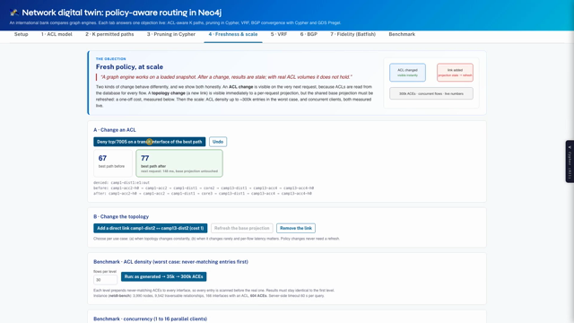

# Policy-aware routing in Neo4j: Cypher, GDS and Pregel

A network digital twin demo. An international bank compares graph engines and has been told that Neo4j cannot do **policy-aware K-paths** or **BGP convergence**.
Each tab answers one of those objections live: the real queries and the real algorithm run in front of the audience, every statement is in the **Cypher audit drawer**
(with parameters and timing), and every performance claim has a **benchmark button** that measures it on the spot, with the size of the instance.

The reference architecture is the [IT service graph](https://neo4j.com/developer/industry-use-cases/agnostic/it-service-graph/it-service-graph/) (dependency and impact analysis), extended here to per-flow routing policy.
The stack is Vite + TypeScript + `@neo4j-ndl/react` + `neo4j-driver`, bolt straight from the browser, hand-rolled deterministic SVG views (no force layout).

## Scenarios

| Tab | Objection | What runs live |
|---|---|---|
| **Setup** | | Bootstrap from an empty database: seeded generators and ingestion are triggered from the app. Reset at any time. |
| **1 · ACL model** | "A graph ignores firewall rules" | Interfaces split into in/out nodes; ACEs as ordered lists on the interface **and** as ACE nodes; IPv4 as integers; first match by sequence, implicit deny. Pick a flow, see which ACE decides at each hop. Equivalence check: both models agree. |
| **2 · K permitted paths** | "Filtering K shortest paths by policy leaves nothing" | The post-filter trap: Yen's top-3 all denied, post-filter returns 0, ACL-before-Yen returns 3. One base projection + `gds.graph.filter` per flow; failed devices and links excluded at filter time. Two ports, same model, different answers, nothing rebuilt. |
| **3 · Pruning in Cypher** | "Cypher enumerates then filters" | QPP with `allReduce` on the group variable as a cost budget. EXPLAIN shows the budget inlined into the expansion; PROFILE shows work follows the budget. Equivalence check: QPP = Yen. |
| **4 · Freshness & scale** | "Stale snapshots, and it won't scale" | Change an ACL and see it at once; add a link and watch the base projection go stale, then refresh it. Live ACL-density benchmark (up to ~300k ACEs, never-matching entries first) and concurrency benchmark. |
| **5 · VRF** | "No isolation" | VRF as one more per-flow filter; declared route leak. |
| **6 · BGP** | "No BGP convergence" | Path enumeration with per-path accumulators vs the fixed point, on random networks (it gets best routes wrong). Converge twice: server-side Cypher loop (`CALL … IN TRANSACTIONS … ON ERROR BREAK`) and the custom GDS Pregel procedure. Superstep-by-superstep animation, what-if with routing-table diff, oscillation flagged. Cypher loop vs Pregel benchmark on growing networks. |
| **7 · Fidelity (Batfish)** | "Is your model exact?" | Optional, off by default. Generates IOS configs for the current network, runs Batfish, compares best routes and categorises the differences. |
| **Benchmark** | | All benchmarks in an isolated database with server-side timeouts. |

The BGP model is deliberately simple and says so: route-maps (match prefix / community; set local-pref, MED, community, AS-path prepend; deny), eBGP/iBGP rules, AS-path loop check, SOO, and best path by local-pref, AS-path length, MED, eBGP over iBGP, router-id.
Not modelled: IGP cost, route reflectors, add-path, aggregation, longest-prefix match, NAT, stateful rules, IPv6.

**The honest message of scenario 7:** Neo4j computes convergence; vendor-exact fidelity is Batfish's job. Use Batfish as the reference for routing tables computed from real configurations, and Neo4j for analysis and targeted what-ifs.

## Run it

Requirements: Docker, Node 20+.

```bash
cp .env.example .env            # set NEO4J_PASSWORD (never commit .env)
docker compose up -d --build    # Neo4j Enterprise + GDS + APOC, and the Pregel jar built in a multi-stage build
npm install
npm run dev                     # then open the Setup tab and press "Ingest demo data"
```

`.env` keys: `NEO4J_URI`, `NEO4J_USER`, `NEO4J_PASSWORD`, `NEO4J_DATABASE` (plus optional `NEO4J_VERSION`, `NEO4J_BOLT_PORT`, `NEO4J_HTTP_PORT`, `BATFISH_SIDECAR_URL`).
If port 7687 is taken on your machine, set `NEO4J_BOLT_PORT` and point `NEO4J_URI` at it.
The password is read by docker compose and by the Vite dev server; it is a local demo, so it ends up in the dev bundle like any bolt URL typed in a browser.

Optional Batfish for scenario 7 (large image):

```bash
docker compose --profile batfish up -d
```

then tick the toggle on the "7 · Fidelity" tab.

### The Pregel procedure

`pregel/src/main/java/demo/bgp/BgpPregel.java` is a normal Neo4j `@Procedure` (`netdt.bgp.pregel`) that drives GDS Pregel directly (the annotation processor is not shipped in the GDS jar).
Messages in GDS Pregel are doubles, so a message is a "my best routes changed" signal and the routes live in double-buffered arrays owned by the computation, swapped in `masterCompute`: exact synchronous BSP semantics, same as the Cypher loop.
`docker/Dockerfile.pregel` compiles it against the GDS jar and libraries of the very image that runs it, and the jar lands in `plugins/`.
The namespace `netdt.*` is both **unrestricted** and **allow-listed** in `docker-compose.yml`, otherwise the procedure is invisible.

**Licence:** unlicensed GDS caps concurrency at 4, and the Pregel procedure needs a GDS licence in production. To lift the cap, mount your key file and uncomment the two licence lines in `docker-compose.yml`.
It is a prototype and would need hardening before production use.

## Correctness checks (also scriptable)

Each correctness claim has an equivalence button in the UI (both ACL models agree; QPP = Yen; Pregel = Cypher loop = reference on 20 random networks, with oscillating networks flagged).
`npm run test:equiv` runs a headless version of the same checks against the running database with the same libraries.

## Layout

```
src/lib/topology.ts   seeded topology and ACL generator, seeded flows
src/lib/cypher.ts     ACL verdict (list model and ACE nodes), base projection, QPP, hop decisions
src/lib/kpath.ts      hybrid (base projection + gds.graph.filter) and per-request K cheapest paths
src/lib/bgp.ts        BGP model, TypeScript reference, seeded networks, Cypher transfer function and server-side loop
src/lib/bgprun.ts     Cypher loop / Pregel / path enumeration runners
src/lib/ios.ts        IOS config generator and Batfish comparison
pregel/               the custom GDS Pregel procedure
batfish-sidecar/      optional minimal HTTP wrapper around pybatfish
```

Synthetic data only; times depend on your hardware.

## Demo video

<!-- demo-video:start -->
[](https://youtu.be/KF1ai3VBvSU)
<!-- demo-video:end -->
